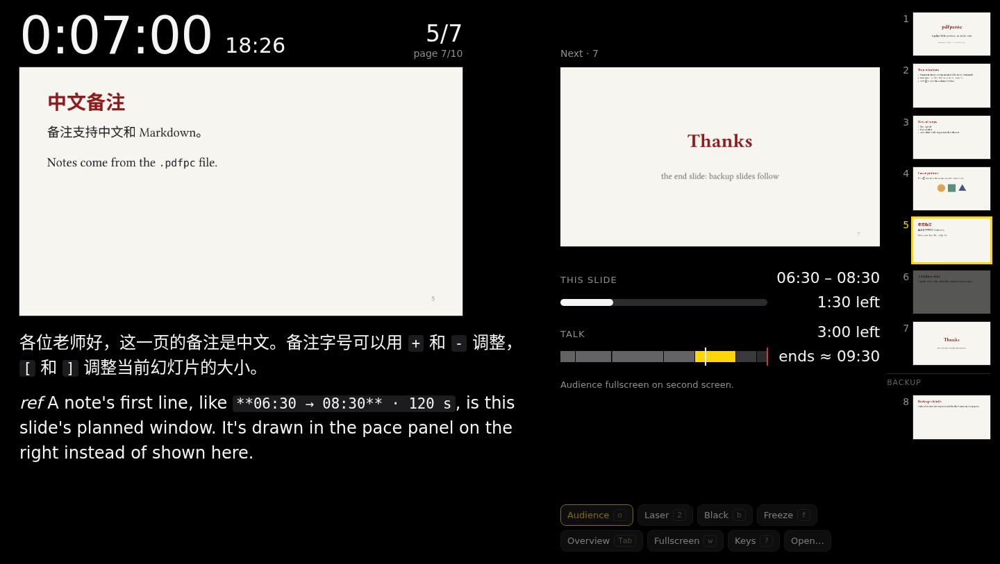

# pdfpcnic

[](https://github.com/youweizhuo/pdfpcnic/releases/latest)
[](https://github.com/youweizhuo/pdfpcnic/actions/workflows/pages.yml)
[](LICENSE)

**A presenter view for PDF slides, in the browser.** On your screen, the slide, its notes, the next slide and how
your time is going; on the projector, the slide alone, fullscreen. It reads [pdfpc](https://github.com/pdfpc/pdfpc)'s
keys and `.pdfpc` files and borrows the look of
[Présentation.app](https://iihm.imag.fr/blanch/software/osx-presentation/). Say it "PDF picnic": pdfpc, packed light
to take anywhere.

**[Open it](https://youweizhuo.github.io/pdfpcnic/)** and drop a PDF on the page, or press **Try the demo deck**.



- **Nothing to install.** A web page, or one HTML file that works offline from a USB stick. There's a Mac app too.
- **Pace for timed talks.** Plan each slide's minutes in its notes. A line under the slide fills as you spend them,
  another shows where the whole talk would end, and the notes dim as you go, about as far as you should have read.
- **Any PDF.** Add a `.pdfpc` file for Markdown notes, reveal steps, hidden slides, the end slide and the talk's
  length, as pdfpc does.
- **Made for someone else's laptop.** `Shift+W` puts the audience fullscreen on the projector. A reload picks up
  mid-talk with the clock running, and the display stays on while a deck is open.
- **Private.** Your files stay on the computer: no accounts, no uploads, no analytics.

## Get it

| | |
| --- | --- |
| **Website** | <https://youweizhuo.github.io/pdfpcnic/>: Chrome or Edge put the audience fullscreen on the projector themselves; in Firefox, drag the window there and double-click it |
| **Offline** | `pdfpcnic.html` from the [latest release](https://github.com/youweizhuo/pdfpcnic/releases/latest): one file, no network needed |
| **Mac app** | [below](#mac-app) |
| **Self-hosted** | `podman run -d -p 8080:8080 ghcr.io/youweizhuo/pdfpcnic:1`, or as a service: [docs/self-hosting.md](docs/self-hosting.md) |

## Presenting

1. Drop the PDF on the page, with its `.pdfpc` file if it has one, and press **Present**. The audience window opens
   with it.
2. `Shift+W` puts the audience fullscreen on the projector, `w` the presenter.
3. `→` to begin. The clock starts when you leave the first slide.

The button outlined in yellow is the next one to press; filled yellow means on. The line over the buttons says what to
do next in yellow, what's in the way in orange, and hints in purple. Set the displays to **Extend**, not mirror. If the
browser blocked the audience window, allow pop-ups and press `o`. For the thumbnails, move the mouse to the right
edge; rest on one to see it large in the next slide's place.

| Key | |
| --- | --- |
| `→` `Space` click / `←` right-click | next / back |
| `g` / `Tab` | go to a slide / overview |
| `b` or `.` / `f` | black / freeze the audience |
| `l` | laser pointer on / off (`2` / `1` too, as in pdfpc) |
| `s` / `p` | start / pause the clock |
| `w` / `Shift+W` | presenter / audience fullscreen |
| `?` | every key, and what the colors mean |

The usual presentation remotes need no setup: next and back send Page Down and Page Up or the arrows, and a black button
sends `.`. A start button that sends F5 and Esc in turn does nothing on F5, as in pdfpc, rather than reload the page;
Esc steps back as it does on the keyboard, so it can end a black screen or the presenter's fullscreen, never the
audience's.

## Mac app

The same presenter, without a browser's limits: the audience window opens behind the presenter, frameless, and `Shift+W`
puts it fullscreen on the projector at once, with nothing to allow. macOS draws the slides itself, as Preview does. Open
a PDF from the Finder, File › Open or by dropping it, and the `.pdfpc` file of the same name beside it comes along, as
in pdfpc. The app updates itself, and the new version opens at the next launch, never mid-talk. To install it, paste
this into Terminal:

```sh
curl -fsSL https://github.com/youweizhuo/pdfpcnic/releases/latest/download/pdfpcnic-mac.zip -o /tmp/pdfpcnic.zip && ditto -x -k /tmp/pdfpcnic.zip /Applications && open /Applications/pdfpcnic.app
```

Or download `pdfpcnic-mac.zip` from the [latest release](https://github.com/youweizhuo/pdfpcnic/releases/latest).
The app isn't signed with a paid Apple developer account, so macOS stops a copy a browser downloaded: click **Done**,
then **Open Anyway** at the bottom of System Settings › Privacy & Security. macOS 12 or later.

## Decks by link

To present without carrying the files, keep the deck on a [deck server](docs/self-hosting.md#a-deck-server) and open its
link, like `pdfpcnic.youwei.xyz/#k3j9x2`, in the address bar: no password, and nothing to install. The Mac app has a box on
its start page to paste the link in. The public website and the offline file don't load decks by link.

## Pacing a talk

Start a slide's note with how long it should take:

```
[36s] Good morning, everyone.
```

pdfpcnic takes the length off the note, adds the lengths up into the talk's plan and draws them. Any tool that writes
notes can write this, with nothing else in the `.pdfpc` file changed. Under the current slide, a line fills as you spend the slide's
time, then turns orange as it runs over. Under the next slide, the whole talk: the time spent, where it would end at
this pace, and a red line at the target. Orange, deeper from a minute late, means hurry; blue, more than a minute
early, means slow down. Without lengths, the `.pdfpc` file's `duration` is split evenly over the slides.

**Save run**, by the clock, saves the times you took as a `.pdfpc` file of lengths. Drop that file on the window,
or any `.pdfpc` file with another name than the deck's (an earlier export, say), to compare the two. The lines, and
each thumbnail's, then show the talk run again in the other file's times: blue where a slide is shorter, orange to red
where longer, with both times and the difference under them. The other file's notes take the next slide's notes'
place, the changed words marked. Meanwhile the clock stands still; **End comparison**, in Save run's place, ends it.

<details>
<summary>The rules for lengths and references</summary>

A length has to open the note, on the first line or a line of its own; anywhere else it's just text. It's in seconds or
minutes: `[36s]`, `[1.5min]`. A slide with no length takes no time, once any note in the file has one. A hidden slide's
time leaves the plan. A backup slide (after `endSlide`) keeps its length, and joins the plan if the end slide moves past
it.

Reveal steps may repeat their slide's note, as Touying exports it, and it counts once. A step with a note and length of
its own adds that time, and a step with no length goes on with the step before.

From `[ref]` to the end of the note is a reference, not spoken: it shows in grey and the dimming skips it.

The `**01:22 → 01:58** · 36 s` lines and `*ref*` paragraphs of 1.4 are deprecated. They still read in a file with no
lengths at all, until 2.0.

</details>

## pdfpc files

pdfpcnic reads pdfpc's JSON `.pdfpc` files (`pdfpcFormat: 2`): notes, reveal steps, hidden slides, `endSlide`,
`duration`, `endTime`, `startTime`, `savedSlide` and `noteFontSize`. Note annotations in the PDF become notes, links
in the PDF work, and the PDF's outline marks sections in the thumbnails and the overview. From Typst with
[Touying](https://touying-typ.github.io/): `typst query deck.typ --field value --one "<pdfpc-file>" > deck.pdfpc`, or
tinymist's "Export PDF + Pdfpc".

Not supported: Beamer notes on half pages, transitions, movies, drawing and spotlight. Changes made while presenting
(the end slide, the bookmark) stay in the browser.

## Privacy

Decks open in the browser and aren't sent anywhere. On the website, a Content Security Policy lets the page connect
only to its own site; the Mac app connects only to GitHub, for updates, and to a deck server when you paste its link. To
resume after a reload, the browser keeps the last deck in its own storage; **Forget** on the start page removes it.

## Contributing

Bug reports, ideas and pull requests are welcome. [CONTRIBUTING.md](CONTRIBUTING.md) has the setup and the checks,
and [docs/architecture.md](docs/architecture.md) the layout of the code.

```sh
npm install
npm run build        # dist/ (the site) and dist/pdfpcnic.html (the offline file)
```

## Credits

Started from the idea of [pdf-webslides-js](https://github.com/misc0110/pdf-webslides-js) by Michael Schwarz. The keys
and file format come from [pdfpc](https://github.com/pdfpc/pdfpc), and the look from
[Présentation.app](https://iihm.imag.fr/blanch/software/osx-presentation/) by Renaud Blanch. Built with PDF.js
(Apache-2.0), [marked](https://marked.js.org/) (MIT) and [DOMPurify](https://github.com/cure53/DOMPurify)
(Apache-2.0 or MPL-2.0).

## License

[MIT](LICENSE)
