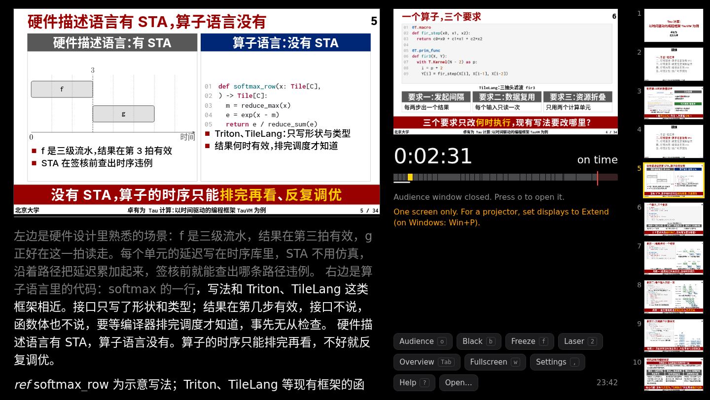

# pdfpcnic

A [pdfpc](https://github.com/pdfpc/pdfpc)-style presenter for PDF slides that runs in the browser. Use it from the
website, or carry it as **one HTML file** for machines with no network. Its layout follows
[Présentation.app](https://iihm.imag.fr/blanch/software/osx-presentation/): black and frameless, with the current
slide and its notes on the left, the next slide beside them, and thumbnails down the edge. All the time sits under the
next slide: the clock and one bar for the whole talk.

**Open it:** <https://youweizhuo.github.io/pdfpcnic/> · **Offline copy:** `pdfpcnic.html` from the
[latest release](https://github.com/youweizhuo/pdfpcnic/releases/latest)



## Presenting

1. Open the page (or `pdfpcnic.html` from a USB stick) and drop your PDF **and** its `.pdfpc` file on it, or choose
   both at once. The `.pdfpc` file is optional; it brings notes, timing, hidden slides and reveal steps.
2. Press `o` to open the audience window.
   - **Chrome and Edge** ask once to manage windows. Allow it, and the audience window moves to the projector and goes
     fullscreen at your next key press.
   - **Other browsers**: drag the window to the projector and double-click it (or press `Shift+W`) for fullscreen.
3. Press `w` to make the presenter fullscreen too, and `→` to start. The timer starts when you leave the first slide.

Files never leave the computer. If the page reloads mid-talk, **Resume** brings back the deck at the same page, with the
timer still running.

On an unfamiliar machine, check that the displays are set to **Extend**, not mirror (`Win+P` on Windows). The presenter
warns you when it sees only one screen. With one screen, `Shift+W` presents in the same window.

## Keys

The same keys as pdfpc, plus `o` for the audience window. Press `?` (or **Help**) for the full list.

| Key | |
| --- | --- |
| `→` `↓` `PgDn` `Space` `Enter`, click | next step |
| `←` `↑` `PgUp` `Backspace`, right-click | back; skips back over the reveal steps of a slide |
| `Shift+PgDn` / `Shift+PgUp` | next / previous slide, skipping reveal steps |
| `Home` / `End` | first slide / end slide |
| `g` | go to a slide number |
| `Tab` | overview |
| `o` | open the audience window |
| `b` / `f` | black screen / freeze the audience on this slide while you move on (a card over your current slide says so) |
| `2` / `1` | laser pointer on / off (`+` `-` change its size) |
| `Esc` | leave black, freeze and laser |
| `s` / `p`, click the clock | start / pause the timer |
| `Ctrl+T` or `Shift+R`, or **Reset** | reset the timer to zero; only while paused |
| `,` | settings: current slide, notes and laser sizes; pace colors |
| `+` / `-` | notes text size |
| `[` / `]` | current slide smaller / bigger, trading room with the notes |
| `w` / `Shift+W` | presenter / audience fullscreen |

## pdfpc support

pdfpcnic reads `.pdfpc` files in pdfpc's JSON format (`pdfpcFormat: 2`). From Typst with
[Touying](https://touying-typ.github.io/), export one with `typst query deck.typ --field value --one "<pdfpc-file>" > deck.pdfpc`
or tinymist's "Export PDF + Pdfpc".

| `.pdfpc` field | |
| --- | --- |
| `pages[].note` | speaker notes, rendered as Markdown (unless `disableMarkdown`) |
| `pages[].label`, `overlay`, `forcedOverlay` | reveal steps grouped into one slide, as pdfpc does |
| `pages[].hidden` | skipped by normal navigation |
| `duration`, `endTime`, `startTime` | countdown, and a countdown to the start |
| `endSlide` | the talk's last slide; later ones are backup |
| `savedSlide` | bookmark (`Shift+M`) |
| `noteFontSize` | notes size, until you change it with `+`/`-` |

As in pdfpc:

- Pages that share a PDF page label count as one slide.
- Note annotations in the PDF (sticky notes and highlights) become notes and are left off the slides.

Not supported: Beamer notes on half pages, transitions, movies, drawing tools and spotlight. Changes made while
presenting (`Ctrl+E` for the end slide, `m` for the bookmark) stay in the browser rather than being written back to
the `.pdfpc` file.

## Pace

The clock counts up from zero, beside the time of day, as in Présentation.app. It never changes color; the pace bars
under it do that job. Click the clock to pause. While it is paused, a **Reset to 0:00:00** button appears; the reset keys
work only then too, so a stray key can't wipe the timer mid-talk. After a reset the clock starts again at your next
move.

A note can start with the slide's planned window, in minutes and seconds from the start of the talk:

```
**01:22 → 01:58** · 36 s
```

pdfpcnic takes that line off the note and draws it instead. It has to be the note's first line, on its own. The arrow
may be `->`, minutes may pass 59, and the `· 36 s` is optional. `**01:22**` alone plans a slide that takes no time.
Reveal steps repeat their slide's line, or carry windows of their own; then each step goes by its own.

Along the foot of the current slide, a thin line fills as you spend its planned time, then turns the late colors; once
you're seriously over, it says by how much. The notes dim along with it, character by character, so the dimmed part
is roughly what you'd have said by now (paragraphs that open with *ref* don't count).

Next to the clock, the whole talk:

- **Early or late**: where the talk would end if you moved on right now, with the slides after this one as planned,
  against the target end (`duration` or `endTime`, else where the plan ends). Reach a two-minute slide on time and it
  starts at "2:00 early", comes to "on time" as you finish the slide, and turns late if you stay on.
- **The bar** is fixed, with a red line at the target end and some room past it: the slides as planned, this one in
  yellow, and under them a thin line of time spent, colored like the early or late beside the clock.

Late always shows: orange, deep orange from 1 minute (serious) and red from 2 minutes (very serious). Early shows, in
blue, only past 1 minute. **Settings** (`,`) changes the three levels, in time or as shares of the talk, and how much the notes dim.

Drag the handle between the current slide and its notes to trade one for the other, the line between the columns to
resize them, and the left edge of the thumbnails to resize them; double-click that edge to hide or show the thumbnails.

Without timing lines, the talk's length is split evenly over the slides (pdfpc's even pace). **Help** (`?`) has a key
to the colors.

## Browsers

Tested in Chrome, from the website and from the offline file. Window placement and automatic fullscreen need a
Chromium browser (Chrome, Edge, Brave and others). Firefox and Safari haven't been tested yet. If you try them, prefer
the website over the offline file, and place the audience window by hand.

## Development

```sh
npm install
npm run dev          # local server
npm run build        # dist/ (the site) and dist/pdfpcnic.html (the offline file)
CHROME_PATH=/path/to/chrome npm run e2e          # end-to-end checks on the offline file
CHROME_PATH=/path/to/chrome npm run e2e -- site  # ... and on the site, with window placement
```

The code is plain TypeScript with [PDF.js](https://mozilla.github.io/pdf.js/) for rendering:

- `src/deck.ts` reads the PDF and `.pdfpc` file into slides.
- `src/render.ts` renders pages at the screen's pixel size and keeps the neighbors ready.
- `src/audience.ts` drives the audience window. It's an empty popup this window draws into, so nothing needs syncing.
- `src/main.ts` holds the presenter.

`demo/` has the demo deck (Typst source, PDF and `.pdfpc`).

## Credits

Started from the idea of [pdf-webslides-js](https://github.com/misc0110/pdf-webslides-js) by Michael Schwarz. The keys
and file format come from [pdfpc](https://github.com/pdfpc/pdfpc), and the look from
[Présentation.app](https://iihm.imag.fr/blanch/software/osx-presentation/) by Renaud Blanch. Built with PDF.js
(Apache-2.0), [marked](https://marked.js.org/) (MIT) and [DOMPurify](https://github.com/cure53/DOMPurify)
(Apache-2.0 or MPL-2.0).

## License

MIT
